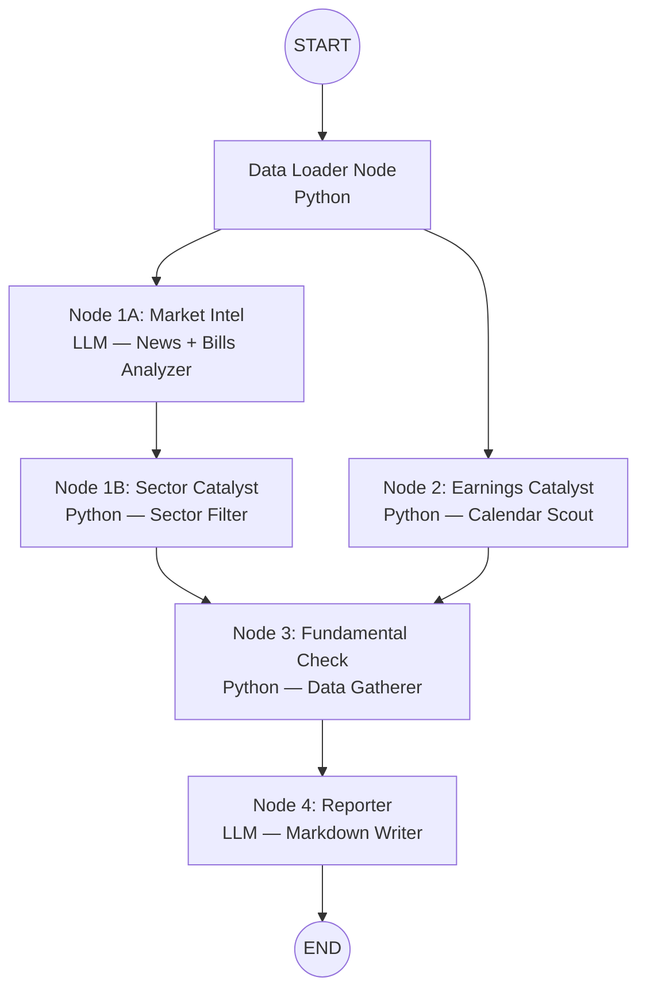

# Implementation Plan: Trading Agent - Phase 1 (Automated Report)

## Goal
Build an autonomous workflow that processes daily financial data (News, Govt Bills, Financials) and generates a `reasoning.md` report with stock suggestions.

> [!NOTE]
> **Decision Log (2026-05-08):** Option A (Deterministic API Fetch) chosen for Phase 1.
> The `fetch_financials()` function will be written as a plain Python function first.
> For Phase 2 (Option B / Agentic), it will be wrapped with `@tool` — **no rewrite needed**, just one decorator added.

## Phase 1: State Design
- [x] **Define `AgentState`**: In `src/state/agent_state.py`, holds:
    - `dataframes`: Dynamic daily data (News, bills) loaded by data loader.
    - `summaries`: Structural summaries of the dynamic data.
    - `sector_analysis`: Insights derived from News and Govt Bills (LLM output).
    - `sector_picks`: Companies matching hot sectors. Tag: `"catalyst": "Sector News"`.
    - `earnings_picks`: Companies reporting earnings today. Tag: `"catalyst": "Earnings Today"`.
    - `financial_data`: Assembled financial data for all shortlisted companies (output of Node 3).
    - `final_report`: The generated Markdown content (output of Node 4).

## Phase 2: Graph Nodes (The "Dual-Track Research Chain")

### Graph Architecture


> [!IMPORTANT]
> **LLM runs only in Node 1A and Node 4. All other nodes are pure Python.**
> Node 3 is a data gatherer — it assembles financial data but does NOT reason about it.

---

### Track 1: Macro & Sectors
- [x] **Node 1A: Market Intelligence** (`market_intel_node.py`):
    - Input: News and Govt Bills summaries.
    - Logic: LLM identifies which sectors are "Hot" or "At Risk". Returns `sector_analysis` dict.
- [x] **Node 1B: Sector Catalyst** (`sector_catalyst_node.py`, renamed from `stock_matcher_node.py`):
    - Input: `sector_analysis` + `stock_sectors.csv` (from `static/`).
    - Logic: Filters stocks down to those in "Hot" sectors. Saves to `sector_picks` with `"catalyst": "Sector News"`.

### Track 2: Earnings Catalysts
- [x] **Node 2: Earnings Catalyst** (`earnings_catalyst_node.py`):
    - Input: Earnings calendar CSV (from `earnings_calendar/` folder).
    - Logic: Filters CSV for rows where `date` == today. Saves to `earnings_picks` with `"catalyst": "Earnings Today"`.

### The Data Gatherer
- [ ] **Node 3: Fundamental Check** (`fundamental_check_node.py`):
    - **Pure Python — NO LLM.**
    - Input: `sector_picks` + `earnings_picks`.
    - Logic (two separate tracks, NOT merged into one flat list):
        - **Earnings track:** For each company in `earnings_picks`, check if CSV exists in `company_financials/earnings/`. Load if found. Flag as `"Report Delayed"` if missing.
        - **Sector track:** For each company in `sector_picks`, call `fetch_financials(company)` (yfinance API). Save result to `company_financials/sector/` for inspection/debugging.
    - Output: `financial_data` dict into state.
    - **Naming util:** Uses `normalize(name)` from `utils/helper_functions.py` to convert `"PVV Infra"` → `"pvvinfra"` for file lookups.

### The Analyst
- [ ] **Node 4: Reporter** (`report_gen_node.py`):
    - **LLM node.**
    - Input: `sector_analysis` + `sector_picks` + `earnings_picks` + `financial_data`.
    - **Relational Prompting (Token Optimization):** Passes `sector_analysis` once at the top of the prompt. LLM connects each stock to its sector catalyst natively — no duplication of context per stock.
    - Output: `final_report` (Markdown string) into state.

---

## Data Folder Structure

```
src/data/
├── static/                      ← Rarely changes (weeks/months)
│   └── stock_sectors.csv
│
├── earnings_calendar/           ← Changes per quarter
│   └── upcoming_qtr_financial_results_YYYY-MM-DD.csv
│
├── company_financials/          ← One file per company, grows over time
│   ├── earnings/                ← Pre-downloaded quarterly result CSVs
│   │   └── pvvinfra.csv
│   └── sector/                  ← API-fetched data, saved for debug inspection
│       └── (written at runtime by fetch_financials())
│
└── dynamic/                     ← Daily only
    ├── current_news/
    └── current_legislative_bills/
```

> [!NOTE]
> The data loader (`data_loader.py`) only scans `dynamic/`. All other folders are loaded **on-demand** by their respective nodes.

---

## Phase 3: File Output
- [ ] Update `main.py` to write `state["final_report"]` to `reasoning.md` after the graph completes.

## Phase 4: Architectural Polish (Before connecting real LLM)
- [ ] **Create `src/prompts/`**: Move all raw LLM instruction strings into `.txt` or `.md` files here.
- [ ] **Create `src/llm/`**: Centralize LLM model initialization (Ollama/Gemma or cloud API) so nodes don't repeat connection code.
- [ ] **Refactor `utils/helper_functions.py`**: Already has `get_path()`, `normalize()`, `get_file_stem()`. Add more helpers as needed. Any generic reusable function that has no LangGraph or trading knowledge belongs here.
- [ ] **Rename `sector_catalyst_node.py`**: Ensure function name inside the file also matches (`sector_catalyst_node()`).
- [ ] **Add `financial_data: dict` to `AgentState`**.
- [ ] **Wrap `fetch_financials()` with `@tool`** for Option B (Agentic) upgrade in Phase 2.

## Verification Plan
- Run `main.py` end-to-end.
- Verify `company_financials/sector/` is populated after a run (confirms API fetch is working).
- Verify `reasoning.md` is created covering both news-based and earnings-based plays.


## Phase 5: Code & Process Intelligence (Dev Helper)
- [ ] **Code Intelligence & Repo Mapping (Token Optimization)**:
  - Explore codebase indexing tools (Tree-Sitter repo maps like Aider, or code property graphs/AST indexers like Graphify).
  - Goal: Automatically produce a compressed architectural summary of the project to save LLM context tokens when picking up development across sessions.
