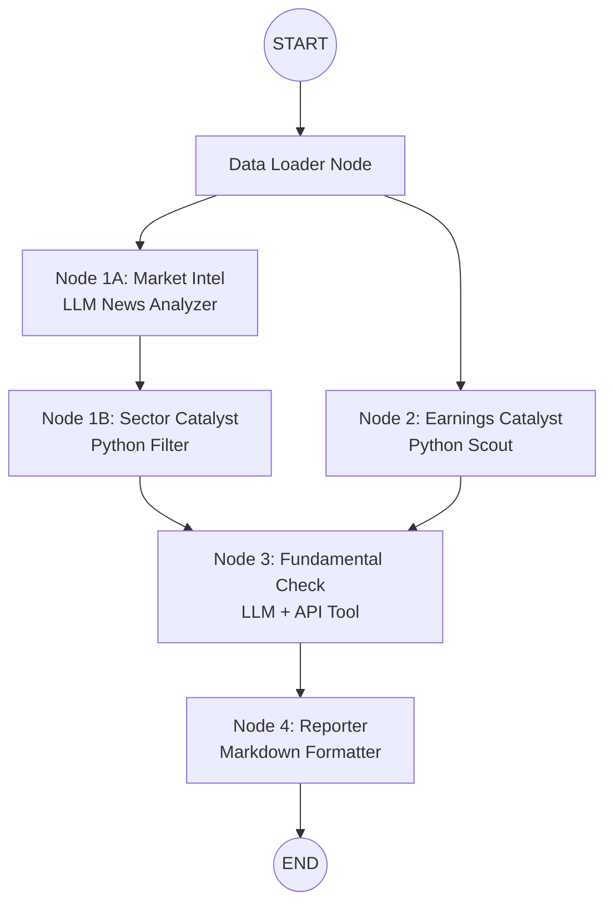

# Implementation Plan: Trading Agent - Phase 1 (Automated Report)

## Goal
Build an autonomous workflow that processes daily financial data (News, Govt Bills, Financials) and generates a `reasoning.md` report with stock suggestions.

## User Review Required
> [!IMPORTANT]
> The architecture has been refined again based on your brilliant idea for **Dynamic API Fetching** for News-driven stocks!
> 
> Because we don't have historical data downloaded for every stock in the universe, we need a way to fetch it on the fly for the stocks picked by Track 1. 
> 
> **Open Question for You:** How do you want to implement this tool?
> - **Option A (Deterministic - Faster/Cheaper):** Node 3 is a pure Python script that loops through the master list. If it sees a stock doesn't have a local file, it runs a Python function (like calling the `yfinance` API) to download it. Then it hands all the data to the LLM for the final report.
> - **Option B (Agentic - More Flexible):** Node 3 is an Agent. We give the LLM the master list of stocks and a `@tool` called `fetch_financials`. The LLM decides to call the tool for each stock, reads the output, and then writes the report.
> 
> *Which approach feels better to you? (I recommend Option A for reliability, but Option B is very "agentic"!).*

## Phase 1: State Design
- [ ] **Define `AgentState`**: In `src/state/agent_state.py`, expand the current `TypedDict` to hold:
    - `dataframes`: The dynamic daily data (News, earnings calendar) from your data loader.
    - `summaries`: The structural summaries of the dynamic data.
    - `sector_analysis`: Insights derived from News and Govt Bills.
    - `sector_picks`: Companies that match the hot sectors.
    - `earnings_picks`: Companies flagged because they report earnings *today*.
    - `final_report`: The generated Markdown content.

## Phase 2: Graph Nodes (The "Dual-Track Research Chain")

### Graph Architecture

### Track 1: Macro & Sectors
- [x] **Node 1A: Market Intelligence**:
    - Input: News and Govt Bills.
    - Logic: LLM identifies which sectors are "Hot" or "At Risk".
- [x] **Node 1B: Stock Matcher**:
    - Input: Impacted sectors + `stock_sectors.csv` mapping.
    - Logic: Filters the universe of stocks down to those in the "Hot" sectors. Saves to `sector_picks` with tag `"catalyst": "Sector News"`.

### Track 2: Earnings Catalysts
- [ ] **Node 2: Earnings Catalyst Check**:
    - Input: `upcoming_qtr_financials` CSV from the dynamic folder.
    - Logic: Filters the CSV for rows where the `date` equals today's date. Extracts the `Company Name` for these specific rows. Saves to `earnings_picks` with tag `"catalyst": "Earnings Today"`.

### The Merger & Analysis
- [ ] **Node 3: Fundamental Check (Now with API Fetching)**:
    - Input: `sector_picks` + `earnings_picks`.
    - Logic: Combines the picks into one master list. 
        - For "Earnings Today" stocks, it reads from `src/data/company_financials/`.
        - For "Sector News" stocks, it dynamically fetches financial data via an API/Tool.
        - **Relational Prompting (Token Optimization):** Instead of duplicating the news context inside every stock dictionary, it passes the `sector_analysis` block once at the top of the LLM prompt, and then lists the stocks. The LLM connects the stock to its sector catalyst natively, preventing context loss while minimizing tokens.
- [ ] **Node 4: Reporter**:
    - Input: All previous reasoning.
    - Logic: Formats the findings into a professional Markdown report.

## Phase 3: File Output
- [ ] **Final Action**: Update the `main.py` execution to write the `final_report` state variable to a local file named `reasoning.md`.

## Phase 4: Architectural Polish (Pre-LLM Integration)
- [ ] **Create `src/prompts/`**: Move all raw LLM instruction strings into text files here.
- [ ] **Create `src/llm/` (or `config/`)**: Centralize the model initialization (e.g., Ollama/Gemma setup) so nodes don't repeat the connection code.
- [ ] **Refactor `utils/`**: Move repeated generic logic (like calculating the base project Path) out of the nodes and into `utils/helper_functions.py`.

## Verification Plan
### Automated Tests
- Run `main.py`.
- Verify the graph accurately branches and merges the picks from both the `stock_matcher` and the new `earnings_catalyst` node before passing them to the fundamental check.
- Check if `reasoning.md` is created with analysis covering both news-based and earnings-based plays.
